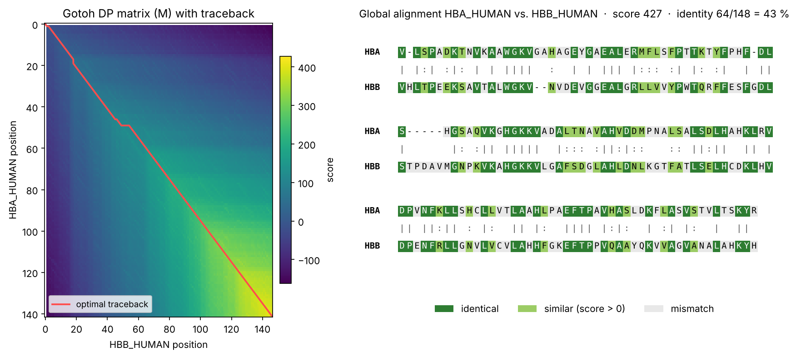
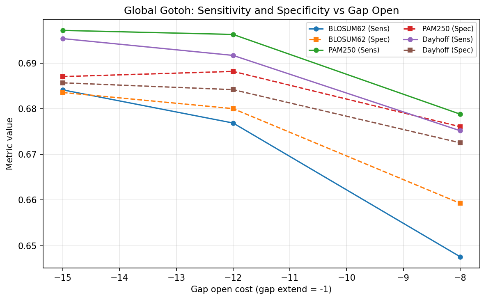

# Protein Alignment Server: Sequence Alignment Algorithms, HOMSTRAD Validation & Parameter Tuning

Web server and analysis pipeline built by group 17 in the Bioinformatics programming lab (Programmierpraktikum Bioinformatik), LMU Munich / TUM, winter semester 2025/26.

The site bundles our own implementations of classic bioinformatics algorithms behind a web interface: pairwise sequence alignment, protein secondary structure prediction (GOR) and smaller sequence and database tools.


<sub>Global alignment of human α- and β-globin computed with our Java implementation of Gotoh (BLOSUM62, gap open −12, gap extend −1): dynamic programming matrix with the optimal traceback (left) and the resulting alignment (right). Script: `src/plot_alignment_example.py`.</sub>

## My part: sequence alignment (with Zeno Fiocco)

- **Algorithms in Java** (`src/alignment/`): global (Needleman-Wunsch and Gotoh with affine gaps), local (Smith-Waterman) and free-shift alignment, with traceback, score checking and a recursion vs. dynamic programming runtime benchmark
- **Validation on HOMSTRAD** (`src/run_validation_homstrad.py`, `src/validation_metrics.py`): compares our alignments with structure-based reference alignments using sensitivity, specificity and further quality metrics
- **Parameter tuning** (`src/tune_params.py`): grid search over gap-open and gap-extend penalties, choosing the setting with the best mean sensitivity
- **Database import** (`src/import_homstrad_to_db.py`): HOMSTRAD families and secondary structure into MariaDB
- **Web interface** (`alignment.html`, `validation.html`, `tuning.html`, `cgi-bin/`): run alignments, validations and tuning from the browser



## Other parts of the project

- **GOR secondary structure prediction** (GOR I, III, IV, V), implemented by Lara Groß and Anna Niederlechner
- **Sequence tools:** ORF finder, DNA → mRNA → protein, PROSITE pattern search, GC content, CRISPR search
- **Database:** sequences, annotations, alignments and structures in MariaDB, queried through CGI scripts

## Structure

```
*.html          web pages (alignment, validation, tuning, GOR, tools, database, FAQ)
cgi-bin/        Python CGI back end
src/            alignment code (Java) and validation, tuning and benchmark pipelines (Python)
plots/          benchmark and tuning results
test/           small example inputs (pairs, seqlib, substitution matrices)
```

## Running the pipelines

```bash
python3 src/run_validation_homstrad.py --homstrad-dir PATH
python3 src/tune_params.py --pairs test/example.pairs --seqlib test/example.seqlib -m test/dayhoff.mat --ref test/example.tuning.ali
python3 src/run_benchmark.py --quick
```

Scripts that connect to the database read the password from the `DB_PASS` environment variable.

## Team

Silja Ohlsen, Zeno Fiocco (alignment) · Lara Groß, Anna Niederlechner (GOR)
Supervision: Prof. Dr. Volker Heun, Felix Offensperger, Armin Hadziahmetovic
